# Commonplace

Commonplace is an offline research assistant for Android. You ask a question, and it answers from Wikipedia and other reference text stored on your phone. Every answer cites its sources. The app has no `INTERNET` permission, so it cannot use the network.

On a Pixel 10, Gemma 4 E2B writes the answer on the Tensor G5 NPU: the first word comes after about 1.3 seconds and the full answer after about 4. Other phones run Ling-3.0-tiny or MiniCPM5-2B on the CPU through llama.cpp.

I built it for the poidh bounty [Build the Best Offline AI Research App for Android](https://poidh.xyz/mainnet/bounty/31). I test it on a Google Pixel 10 with GrapheneOS and 12 GB of RAM.

[Download the APK](https://github.com/0xPD33/commonplace/releases/latest) · [Install](#install-on-a-phone) · [Bounty requirements](#bounty-requirements) · [Under the hood](#under-the-hood) · [Packs on Hugging Face](https://huggingface.co/datasets/0xPD33/commonplace-packs) · [Build from source](docs/INSTALL.md#build-from-source) · [Changelog](CHANGELOG.md)


*Right: a real screen recording of 0.4.1 on a Pixel 10 in airplane mode. Gemma 4 E2B writes on the Tensor G5 chip. The video is not sped up. An older 95-second tour of 0.4.0 with sound is an [MP4 (17 MB)](docs/media/commonplace-showcase.mp4).*

<br clear="right">

## Screens

All screenshots come from the app in airplane mode. The answers are real.

<table>
  <tr>
    <td width="25%">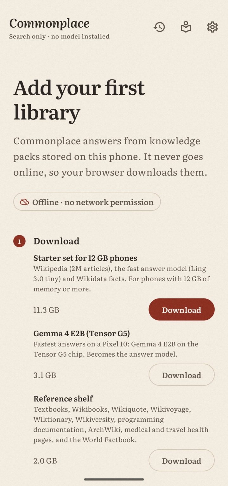</td>
    <td width="25%">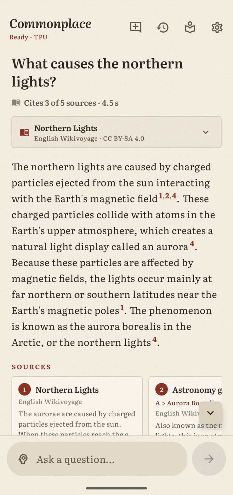</td>
    <td width="25%">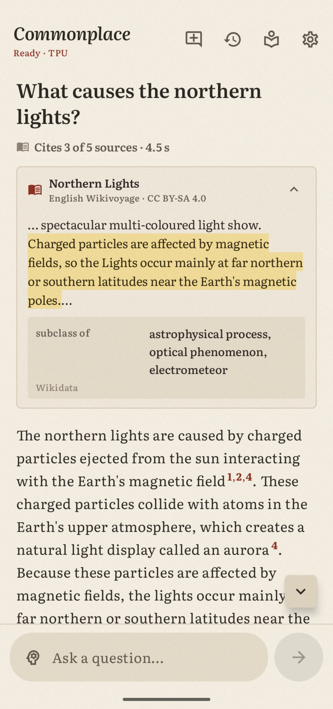</td>
    <td width="25%">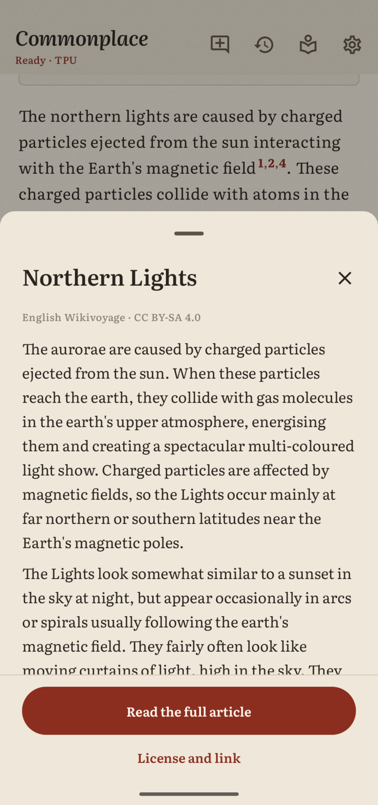</td>
  </tr>
  <tr>
    <td>The first run lists the files for your phone. Your browser downloads them.</td>
    <td>Every answer cites its sources. Gemma wrote this one in 4.5 s.</td>
    <td>The best passage folds open above the answer.</td>
    <td>Tap a citation to read the source with its credit and license.</td>
  </tr>
  <tr>
    <td width="25%">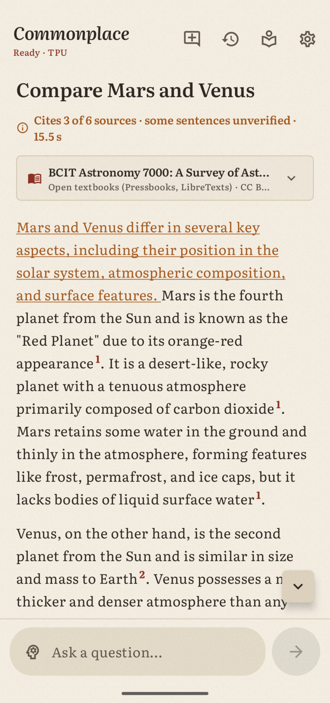</td>
    <td width="25%">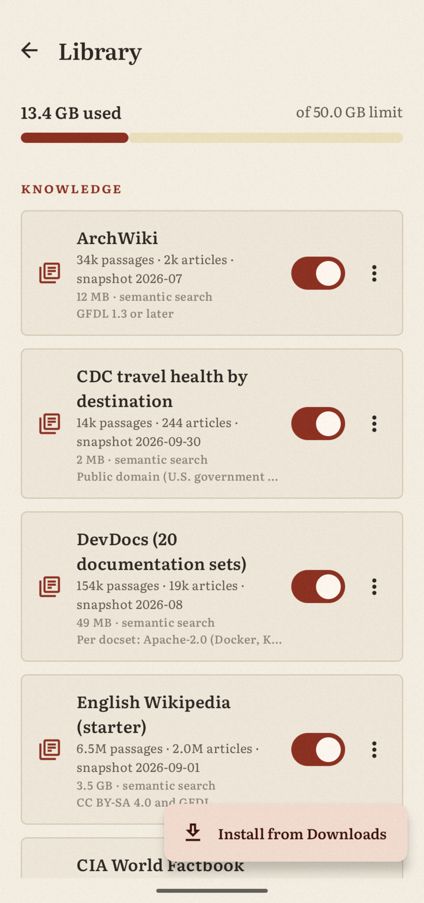</td>
    <td width="25%">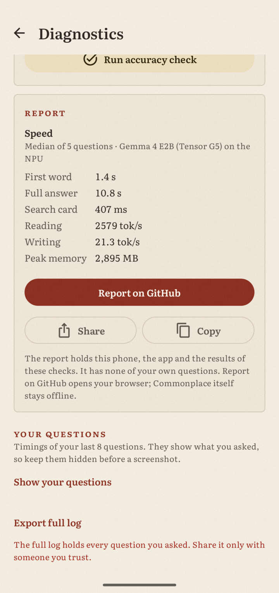</td>
    <td></td>
  </tr>
  <tr>
    <td>Compare two things. The app marks sentences that it cannot verify.</td>
    <td>Switch each source on or off. The meter shows the 50 GB limit.</td>
    <td>Diagnostics measures speed and accuracy. The report holds none of your questions.</td>
    <td></td>
  </tr>
</table>

## The idea

A phone is too slow to read Wikipedia for every question. So a desktop computer does the reading once: it splits the text into short passages and builds search indexes for them. You download the result one time. After that, your phone looks things up and writes a short answer from what it finds.

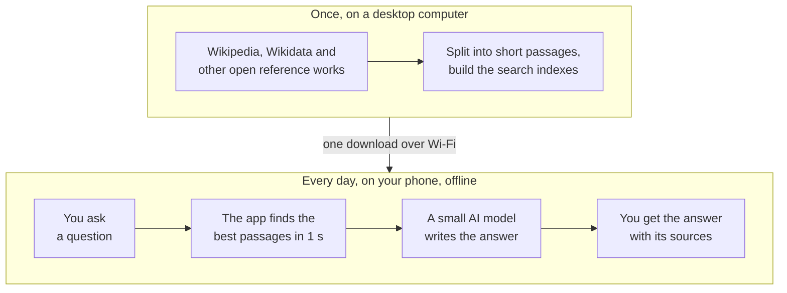

You see the best passage and its source in under a second. The written answer follows, and you can open each cited passage to check it.

You do not have to trust a setting: Android itself blocks the network, because the app does not ask for the `INTERNET` permission. You download the packs once with your browser, and the app imports them from the Downloads folder.

## Install on a phone

You need an Android phone with a 64-bit ARM CPU, Android 12 or later and 8 GB of RAM. Google Play Services are not necessary.

| Your phone | Download | Size |
|---|---|---|
| 12 GB of RAM | `commonplace-starter.tar`, with the fast model Ling-3.0-tiny | 11.3 GB |
| 8 GB of RAM | `commonplace-starter-small.tar`, with the small model MiniCPM5-2B | 8.1 GB |
| Any (recommended) | Reference shelf, `commonplace-breadth.tar`: travel guides, textbooks, how-to guides and medical pages | 2.0 GB |
| Pixel 10 | Gemma 4 E2B (Tensor G5), the fastest model | 3.1 GB |

The first import needs about twice the size of the files in free storage. Use Wi-Fi: on a 2.4 GHz network (about 1 MB/s), the 11.3 GB file took 3 hours.

1. On the phone, open the [latest release](https://github.com/0xPD33/commonplace/releases/latest), download `commonplace-<version>.apk` and install it.
2. Open Commonplace and tap **Open Library**. The **Get started** card lists the files for your phone.
3. Under **Get more**, tap each file, then tap **Download**. The browser saves the files in **Downloads**.
4. Tap **Install from Downloads** and select all the files: long-press one, tap the others, then tap **Select**. The app checks every byte with SHA-256 while it copies.
5. When the app asks, tap **Delete** to remove the downloaded files.
6. Go back and ask a question. The first question is slower, because the app loads the model. The top bar shows **Ready** when the model is loaded.

To check that the app is offline, turn on airplane mode, or open **Settings > Apps > Commonplace > Permissions**.

Questions to try, each in a new conversation:

- "Compare the Nile and the Amazon": Wikidata facts side by side, then a written comparison.
- "Walking 5 km an hour, how long would it take to walk the length of the Great Wall of China?": code computes the time from Wikidata.
- "How do I treat a minor burn?": steps in order, with citations.
- "Do I need to tip in Japan?": a travel answer from Wikivoyage. It needs the Reference shelf.
- "Who built the pyramids of Giza?", then "How long did it take to build them?": a follow-up keeps the topic.

[docs/INSTALL.md](docs/INSTALL.md) has the other packs, the install from a computer and the build from source.

## Bounty requirements

| Requirement | How Commonplace meets it |
|---|---|
| Runs on Android and GrapheneOS hardware | I run it on a Pixel 10 with GrapheneOS (Android 17). The minimum is Android 12 on a 64-bit ARM CPU. |
| At most 12 GB of RAM | Peak memory is 5.4 GB with Ling, 2.3 GB with Gemma on the NPU and 2.6 GB with MiniCPM5-2B ([BENCHMARKS](docs/BENCHMARKS.md)). |
| At most 50 GB in total | The starter set uses 11.3 GB (8.1 GB for 8 GB phones). A Pixel 10 with the Reference shelf and the Gemma pack uses 16.4 GB. All packs use 36.5 GB, or 39.7 GB with the Gemma pack, plus the app. The app refuses an import that takes the total above 50 GB. |
| Offline, with no network requests | The APK has no `INTERNET` permission. The release script stops if the permission appears. |
| No Google Play Services | The APK contains no `com.google.android.gms` classes. |
| Explanation, comparison, synthesis and reasoning | A comparison runs one search for each item and computes ratios from Wikidata in code. Follow-ups use the earlier turns, and "Are you sure?" checks the last answer against the sources. A thinking mode lets the model reason first. |
| Usable speed on a phone | See [Results on the Pixel 10](#results-on-the-pixel-10). |
| Public repository with code, assets and instructions | This repository holds all code, and each release has a tag. The packs are on [Hugging Face](https://huggingface.co/datasets/0xPD33/commonplace-packs). [docs/PACKS.md](docs/PACKS.md) shows how to build them. |
| Documents the models, datasets and indexes | [MODELS](docs/MODELS.md), [DATASETS](docs/DATASETS.md) and [PACKS](docs/PACKS.md). |
| More than 50% as good as internet search with a frontier model | Commonplace with Ling gets **64%** of the score of Claude Opus 5.5 with web search on 100 graded questions (95% interval 59–69%, [EVAL](docs/EVAL.md)). |

### How I measure quality

Claude Opus 5.5 with web search answers each question as the baseline. A second Claude call grades both answers blind on correctness, completeness, grounding and usefulness. The score ratio is our mean score divided by the baseline's mean score.

The 64% comes from the reference run `v2-ref-ling` (2026-11-02, before 0.4.0): Ling with the phone's settings, the Starter set and the Reference shelf, on the desktop.

| Set | Score ratio |
|---|---|
| Numbers | 0.85 |
| Recent events | 0.82 |
| Comparisons | 0.68 |
| Facts | 0.66 |
| Multi-step questions | 0.62 |
| Explanations | 0.58 |
| Rare topics | 0.57 |
| Travel | 0.53 |
| Misspelled or spoken questions | 0.52 |
| How-to | 0.46 |
| Answer not in the library | 0.38 |

- **What the library adds.** The same model with no library gets 0.47 on these questions.
- **Gemma.** A desktop copy of Gemma 4 E2B gets 0.60 on these questions. On the Pixel, 63 older seed questions gave Gemma 0.50, or 0.51 with the Reference shelf.
- **Conversations.** Ling gets 0.65 on 30 locked threads (0.59 without the small-talk threads), and Gemma on the phone 0.605 ([BENCHMARKS](docs/BENCHMARKS.md#conversations)).
- **Other limits.** The baseline wins almost every single question (99 of 100). Commonplace gets a share of the points, not of the wins. Each type has only 3 to 20 questions, so a type moves a lot between runs. The choice of questions gives an uncertainty of about ±0.05.
- **0.4.0.** The release has no full score ratio. The [release gate](docs/BENCHMARKS.md#experiments-and-decisions) compared 0.4.0's Ling with the old prompt at 400 evidence tokens: 20 better, 18 tied, 22 worse (mean +0.03), abstention 52 of 60 against 45. Read its caveats in BENCHMARKS.

### What fits on the phone

<picture>
  <source media="(prefers-color-scheme: dark)" srcset="docs/images/chart-storage-dark.svg">
  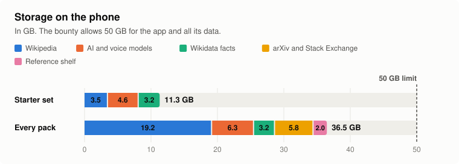
</picture>

## Results on the Pixel 10

| Measure | Gemma 4 E2B on the NPU | Ling-3.0-tiny on the CPU |
|---|---|---|
| Answer card (search, rerank, best passage) | 0.61 s median | 0.50 s median |
| First word | 1.34 s median | 6.02 s median on a warm phone; 5.4–6.5 s from a cool start |
| Full answer | 4.23 s median | 10.0 s median |
| Writing speed | 25.8 tokens/s on a warm phone; 25 to 31 before | 13.1 tokens/s on a warm phone; 14.9 from a cool start |
| Model start after the app was closed | 6 to 9 s | About 16.5 s (about 25 s without the saved warm-up state) |
| Peak memory | 2.3 GB | 5.4 GB |

First word, full answer and warm-phone speed: 62 questions typed in the app, on the final 0.4.0 code for Gemma (2026-11-06) and on the 0.4.0 candidate for Ling (2026-11-05). Cool starts: 9 demanding prompts on the final code, 2026-11-06. Card, model start and Gemma's peak memory: earlier builds. [docs/BENCHMARKS.md](docs/BENCHMARKS.md) names each date and build.

Known limits:

- Ling and MiniCPM get slower when the phone gets hot. On an older build, Ling's median first word rose from 13 s to 28–30 s over 75 questions. Gemma kept its speed over 126 questions in 76 minutes (first word 2.8 s at most), but those runs did not make the phone hot ([BENCHMARKS](docs/BENCHMARKS.md#long-sessions-and-heat)).
- Ling holds about 5 GB while it is loaded. Android 17 limits a hidden app to 3 GiB, so the app unloads Ling when it goes off screen, or when a running answer ends, and loads it again on return. On a Pixel 10 that took about 15 s and about 5 s in two tests. Other apps can still be killed in the seconds after you leave, and a full phone can still kill this app.
- Only a Pixel 10 (Tensor G5) runs Gemma on its NPU. Other phones answer on the CPU. On 63 seeds asked on the phone, Ling won more often head to head (33 / 7 / 21, not significant). The judge rates Gemma's answers as correct as Ling's, but less complete.
- Ling's answer to "How do I fix a squeaky door hinge?" can give door-fitting steps instead of the fix. A citation can also point to the wrong article, for example a pipe-welding article for a leaking tap. Asked who won Eurovision 2025, Ling names the singer instead of the country and gives the wrong song.
- Voice input (Moonshine, the optional `voice-en` pack) is English only. I tested real speech on the desktop, not yet on a phone's microphone.
- Read aloud uses only an offline voice for the answer's language. Without one, the app says so and does not fall back to a network voice. The optional `tts-en` pack adds a bundled English voice (Phonon 31m, Apache-2.0, 65 MB).

## Under the hood

<details>
<summary>Show the technical diagrams</summary>

### System overview

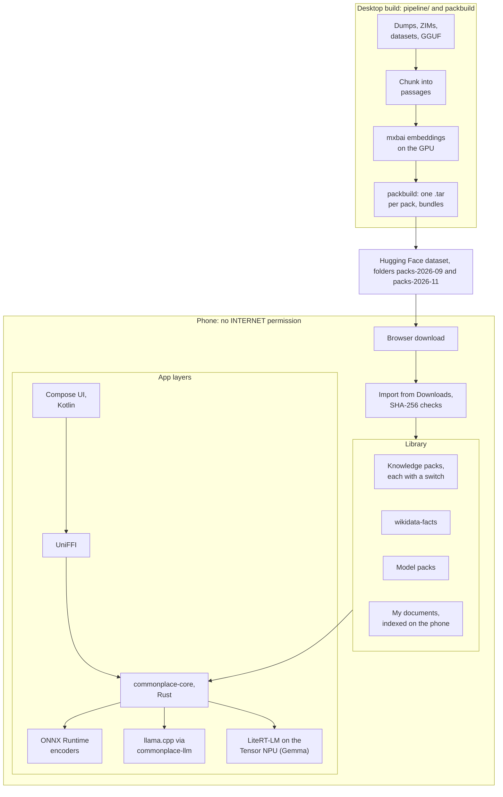

### From a question to a cited answer

The turn-kind, follow-up and intent heads are small classifiers on the embedding of the question.

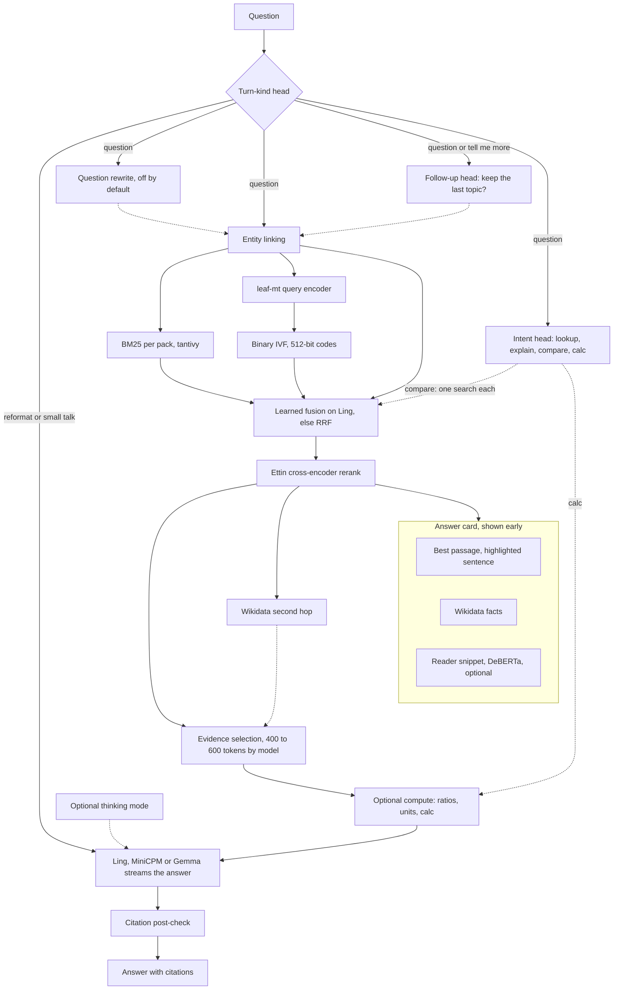

</details>

### Design choices

1. **Search in about one second.** Keyword search (tantivy BM25) and semantic search (512-bit binary codes in an IVF index, leaf-mt query encoder) run in parallel. With Ling, a small learned scorer merges the two lists from ranks and scores alone, and it never sees the text. Other models use reciprocal-rank fusion. An Ettin-17m cross-encoder then reranks the top 24 passages on the phone. I distilled it from Ettin-400m on 23,012 of the app's own search pools ([model](https://huggingface.co/0xPD33/ettin-reranker-17m-commonplace)).
2. **An answer card before the answer.** The best passage, Wikidata facts and the source list appear before the model writes a word. For a simple lookup, an extractive reader adds a short snippet.
3. **A small model reads short evidence.** The answer model gets short evidence, not whole articles: 400 tokens for Ling (450 on how-to questions), 600 for MiniCPM (400 on a warm phone) and 600 for Gemma on the NPU. With Ling, a trained head picks one connected window from each passage. llama.cpp keeps the state of the system prompt in memory and in a file, so each question pays only for its own evidence, also after a restart.
4. **Three models.**
   - Ling-3.0-tiny (7.9B parameters, 1.3B active for each token, MIT) runs in RAM. Patches to llama.cpp make its prefill 50% to about 2 times faster, and they compute only the output rows it can use.
   - MiniCPM5-2B (2.5B parameters, Apache-2.0) is for 8 GB phones.
   - Gemma 4 E2B (Apache-2.0) runs on the Tensor G5 NPU through LiteRT-LM with speculative decoding. It starts on the system prompt and the question while the search runs. The app ships its own build of Google's Tensor dispatch library, because the prebuilt one crashes ([MODELS](docs/MODELS.md#runtimes)).
5. **Checks in code, not in a second model.** The app removes citations to sources that do not exist. It underlines a sentence when the evidence does not have one of its numbers, or when a sentence without a citation lacks most of its rare words in the evidence. When the sources do not answer a question, the model says so first and can then answer from general knowledge, with those sentences underlined. Code does unit conversions, percentages and Wikidata ratios.
6. **How-to answers.** A "How do I" question gets a separate prompt: the model writes the method it knows and follows the sources for health and safety steps. Steps that no source supports show as unverified.
7. **Comparisons and follow-ups.** A comparison runs one search for each item, and each Wikidata entity is a numbered source. Wikidata follows one link for a related thing ("the highest point of the country that hosted the 1964 Olympics"). A trained head decides if a message continues an earlier turn. "Tell me more" searches again and prefers new passages. "Make it shorter" rewrites the last answer without a search. "Are you sure?" checks the answer against the sources.
8. **Thinking mode.** The brain button lets the model reason before it answers, for 256 tokens by default. Settings has a slider.
9. **Your own documents.** "My documents" turns a PDF, text or Markdown file into a small pack on the phone. Citations show the page, and "Ask this document" limits a conversation to one document.

## Desktop command line

The same Rust core runs on a desktop computer, and the evaluation uses this build.

```sh
nix develop            # or install the tools listed in docs/INSTALL.md
scripts/fetch-models.sh encoders llm-fast
cd core && cargo build --release -p commonplace-cli -p packbuild && cd ..
core/target/release/commonplace --model data/models/llm/Ling-3.0-tiny-Q4_0.gguf ask "Why is the sky blue?"
```

The command line reads packs from `data/library/packs/`. To install a pack or a bundle there, run `tar -xf <file>.tar -C data/library/packs`.

## Repository

| Path | Contents |
|---|---|
| `core/` | Rust workspace: `commonplace-core`, `commonplace-llm` (llama.cpp bindings), `commonplace-ffi` (UniFFI), `commonplace-cli`, `packbuild` |
| `android/` | Kotlin and Jetpack Compose app |
| `pipeline/` | Python build steps for the packs and the trained heads |
| `eval/` | Evaluation harness and the runs that the docs cite |
| `patches/` | Patches to llama.cpp that the build applies, and tested patches that it does not |
| `scripts/` | Downloads, Android build, emulator, end-to-end test driver, phone benchmarks, release |
| `docs/` | [INSTALL](docs/INSTALL.md), [MODELS](docs/MODELS.md), [DATASETS](docs/DATASETS.md), [PACKS](docs/PACKS.md), [BENCHMARKS](docs/BENCHMARKS.md), [EVAL](docs/EVAL.md) |
| `third_party/llama.cpp` | llama.cpp at tag `b12032` (git submodule) |

## License

The code is under Apache-2.0 ([LICENSE](LICENSE)). The packs and models keep the licenses of their sources: for example, Wikipedia is CC BY-SA 4.0 and GFDL, Wikidata is CC0, Ling-3.0-tiny is MIT, and MiniCPM5-2B and Gemma 4 E2B are Apache-2.0.

Each pack contains a `NOTICE.txt` with its credit and full license texts ([sources](pipeline/notices)). [DATASETS](docs/DATASETS.md) and [MODELS](docs/MODELS.md) list each license. The app shows its dependencies' licenses in **Settings > Open-source licenses** (`scripts/licenses.py`).
