# Commonplace

Commonplace is an offline research assistant for Android. You ask a question, and it answers from Wikipedia and other reference text stored on your phone. Every answer cites its sources. The app has no `INTERNET` permission, so it cannot use the network.

On a Pixel 10, Gemma 4 E2B writes the answer on the Tensor G5 NPU: the first word comes after about 2 seconds and the full answer after 6 to 8. Other phones run Ling-3.0-tiny or MiniCPM5-2B on the CPU through llama.cpp.

I built it for the poidh bounty [Build the Best Offline AI Research App for Android](https://poidh.xyz/mainnet/bounty/31). I test it on a Google Pixel 10 with GrapheneOS and 12 GB of RAM.

[Download the APK](https://github.com/0xPD33/commonplace/releases/latest) · [Screens](#screens) · [The idea](#the-idea) · [Install on a phone](#install-on-a-phone) · [Bounty requirements](#bounty-requirements) · [Under the hood](#under-the-hood) · [Packs on Hugging Face](https://huggingface.co/datasets/0xPD33/commonplace-packs) · [Build from source](docs/INSTALL.md#build-from-source) · [Changelog](CHANGELOG.md)

[](docs/media/commonplace-showcase.mp4)

*Ask, read the evidence, get the answer: 16 seconds from the tour, recorded on a Pixel 10. The full 95-second tour with sound is an [MP4 (17 MB)](docs/media/commonplace-showcase.mp4). The video speeds up the waits and shows each speed-up on screen.*

## Screens

All screenshots come from the app in airplane mode. The answers are real.

<table>
  <tr>
    <td width="25%">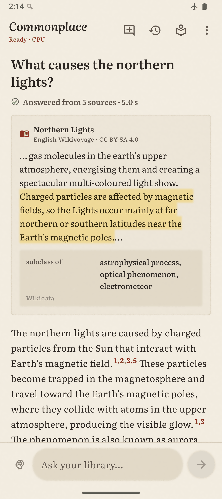</td>
    <td width="25%">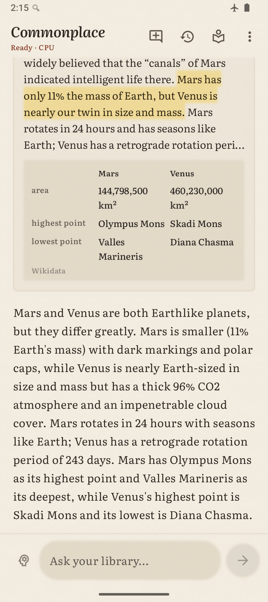</td>
    <td width="25%">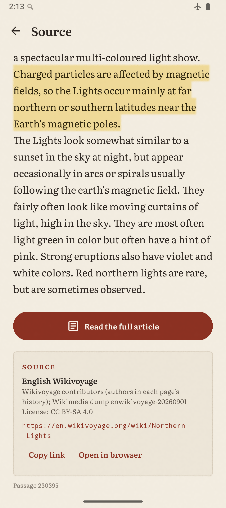</td>
    <td width="25%">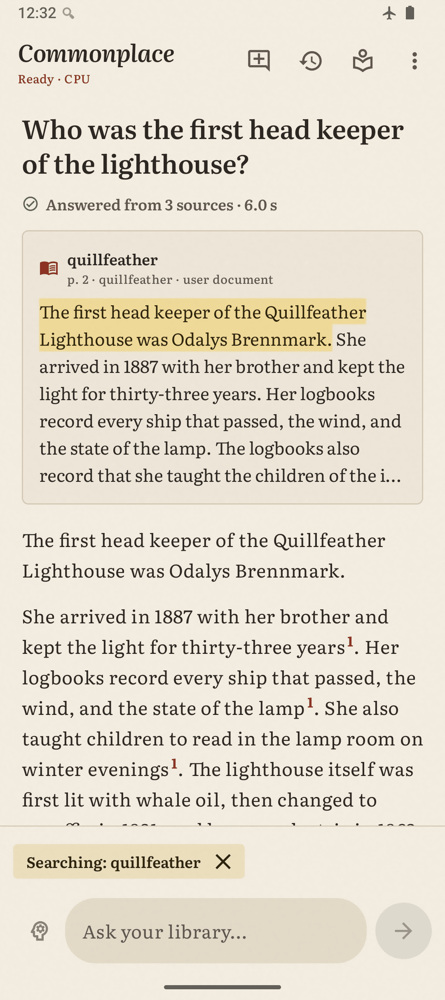</td>
  </tr>
  <tr>
    <td>Ask a question. The best passage appears first, then the written answer with citations.</td>
    <td>Compare two things. Facts from Wikidata appear side by side.</td>
    <td>Open any source to check it. Each source shows its credit and license.</td>
    <td>Add your own PDF and ask questions about it.</td>
  </tr>
  <tr>
    <td>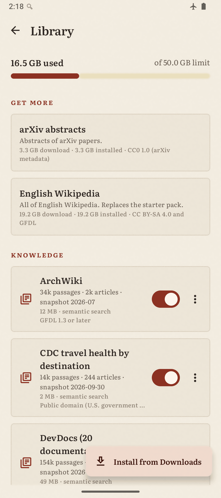</td>
    <td>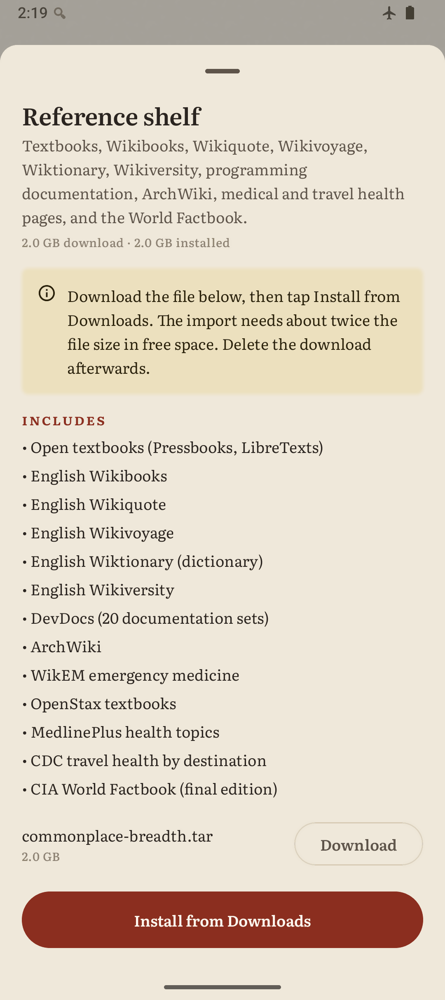</td>
    <td></td>
    <td></td>
  </tr>
  <tr>
    <td>Switch each source on or off. The meter shows the 50 GB limit.</td>
    <td>Get more packs. One file holds several packs.</td>
    <td></td>
    <td></td>
  </tr>
</table>

## The idea

A phone is too slow to read Wikipedia for every question. So a desktop computer does the reading once: it splits the text into short passages and builds search indexes for them. You download the result one time. After that, your phone only looks things up and writes a short answer from what it finds.

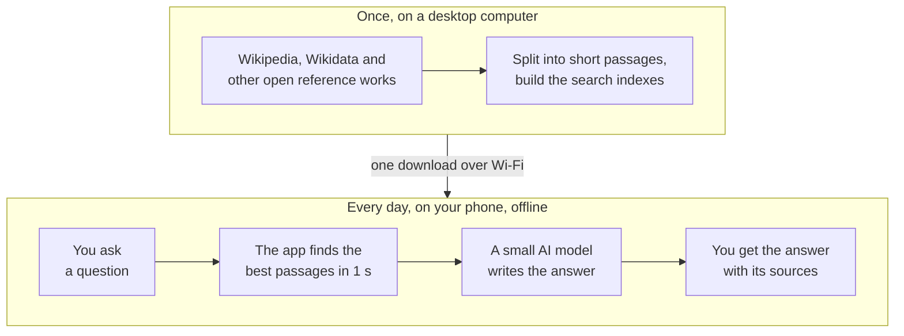

## What happens when you ask

You see the best passage and its source in under a second. The written answer follows a few seconds later. The answer cites the passages it uses, and you can open each one to check it.

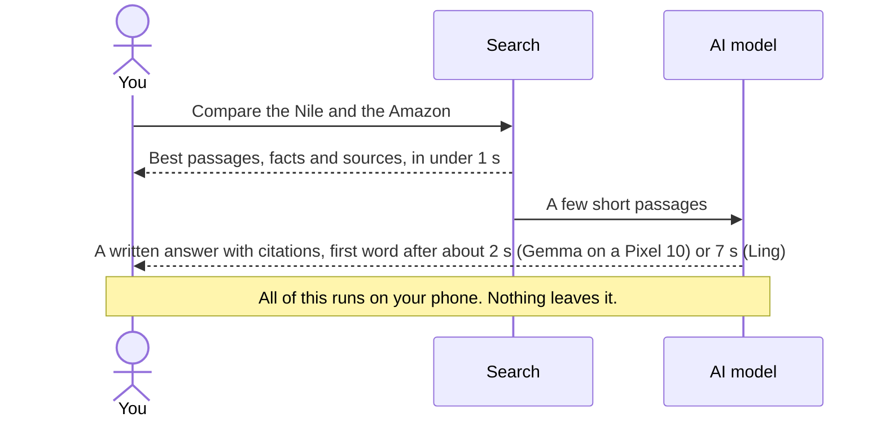

## Offline by design

You do not have to trust a setting. Android itself blocks the network for Commonplace, because the app does not ask for the `INTERNET` permission. You download the packs once with your browser, and the app imports them from the Downloads folder.

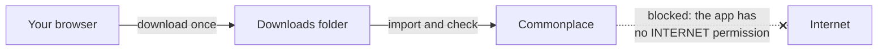

## Install on a phone

You need:

- An Android phone with a 64-bit ARM CPU and Android 12 or later. Google Play Services are not necessary.
- 8 GB of RAM. A phone with 12 GB gets the starter set with the fast model (Ling-3.0-tiny, 11.3 GB). A phone with 8 GB gets the starter set with the small model (MiniCPM5-2B, 8.1 GB). The app marks the set for your phone. On a Pixel 10, the Gemma pack (3.1 GB) adds the fastest model.
- Free storage of about twice the downloaded files for the first import. After the import, the app uses 11.3 GB or 8.1 GB, plus 2.0 GB for the Reference shelf.
- A Wi-Fi connection for the downloads: 13.3 GB on a 12 GB phone, 10.1 GB on an 8 GB phone, and 3.1 GB more for the Gemma pack on a Pixel 10. On a 2.4 GHz network (about 1 MB/s), the 11.3 GB starter set took 3 hours on the Pixel 10. Use a 5 GHz network if you can.

Steps:

1. On the phone, open the [latest release](https://github.com/0xPD33/commonplace/releases/latest) and download `commonplace-<version>.apk`. Open the file and install the app.
2. Open Commonplace. The **Get started** card lists the files for your phone.
3. Tap **Open Library**. Under **Get more**, tap each file from the card, then tap **Download**. The browser saves the files in **Downloads**:
   - `commonplace-starter.tar` (11.3 GB, for 12 GB phones) or `commonplace-starter-small.tar` (8.1 GB, for 8 GB phones).
   - The **Reference shelf**, `commonplace-breadth.tar` (2.0 GB). It adds travel guides, textbooks, how-to guides and medical pages. With it, travel answers score 53% instead of 41%.
   - On a Pixel 10, **Gemma 4 E2B (Tensor G5)** (3.1 GB). It runs on the Tensor chip and answers about three times faster.
4. When the downloads are complete, tap **Install from Downloads** in the Library. Select all the files: long-press one, tap the others, then tap **Select**. The app checks every byte with SHA-256 while it copies the files. The Reference shelf took less than 1 minute on the Pixel 10, and the Gemma pack 28 s.
5. When the app asks, tap **Delete** to remove the downloaded files.
6. Go back and ask a question. The first question is slower, because the app loads the model into memory. The top bar shows **Ready** when the model is loaded.

To check that the app is offline, turn on airplane mode. Or open **Settings > Apps > Commonplace > Permissions**: the app has no network permission.

Questions to try, each in a new conversation:

- "Compare the Nile and the Amazon": Wikidata facts side by side, then a written comparison.
- "Walking 5 km an hour, how long would it take to walk the length of the Great Wall of China?": code computes the time from Wikidata.
- "Do I need to tip in Japan?": a travel answer from Wikivoyage. It needs the Reference shelf.
- "What vaccinations do I need for Kenya?": an answer from the CDC travel health pages. It also needs the Reference shelf.
- "Who built the pyramids of Giza?", then "How long did it take to build them?": a follow-up question keeps the topic.

[docs/INSTALL.md](docs/INSTALL.md) has the other packs, the install from a computer and the build from source.

## Bounty requirements

| Requirement | How Commonplace meets it |
|---|---|
| Runs on Android and GrapheneOS hardware | I run it on a Pixel 10 with GrapheneOS (Android 17). The minimum is Android 12 on a 64-bit ARM CPU. |
| Works in a maximum of 12 GB of RAM | The peak memory of the app is 5.3 GB with Ling, 2.3 GB with Gemma on the NPU and 2.6 GB with MiniCPM5-2B on 8 GB phones ([BENCHMARKS](docs/BENCHMARKS.md)). |
| Uses no more than 50 GB in total | The starter set uses 11.3 GB (8.1 GB for 8 GB phones). With the Reference shelf and the Gemma pack, a Pixel 10 uses 16.4 GB. All packs together use 36.5 GB, plus the app. The app refuses an import that takes the total above 50 GB. |
| Works offline, with no network requests during use | The APK has no `INTERNET` permission, so Android blocks all network access. The release script stops if the permission appears. You download the packs once with the browser. |
| No Google Play Services | The app uses no Google Play Services library: the APK contains no `com.google.android.gms` classes. |
| Explanation, comparison, synthesis and reasoning | A comparison runs one search for each item and computes ratios from Wikidata in code. Follow-up questions use the earlier turns, and "Are you sure?" checks the last answer against the sources. A thinking mode lets the model reason before it answers. |
| Usable speed on a phone | On a Pixel 10 with the Gemma pack, the answer card with the best passage comes after 0.6 s, the first word after about 2 s and the full answer after 6 to 8 s. Other phones use Ling on the CPU: the first word comes after about 7 s, and the model writes 16 to 17 tokens per second on a cool phone ([results](#results-on-the-pixel-10)). |
| Public GitHub repository with code, assets and instructions | This repository holds all code, and each release has a tag. The packs are on [Hugging Face](https://huggingface.co/datasets/0xPD33/commonplace-packs), and [docs/PACKS.md](docs/PACKS.md) shows how to build them again. |
| Documents the models, datasets and indexes | [MODELS](docs/MODELS.md), [DATASETS](docs/DATASETS.md) and [PACKS](docs/PACKS.md). |
| More than 50% as good as internet search with a frontier model | On 63 of my own questions, Commonplace gets 53% of the score of Claude Opus 5.5 with web search ([EVAL](docs/EVAL.md)). With the optional Reference shelf it gets 56%, and on 30 locked conversation threads 65% (59% without the small-talk threads) ([BENCHMARKS](docs/BENCHMARKS.md#conversations)). Gemma 4 E2B, the faster model for a Pixel 10, gets 50% on the questions on the phone (51% with the Reference shelf) and 64% on the threads. See the limits below. |

How I measure quality: Claude Opus 5.5 with web search answers each question as the baseline. A second Claude call grades both answers blind on correctness, completeness, grounding and usefulness. The score ratio is our mean score divided by the baseline's mean score.

Limits of this measurement:

- 63 questions is a small set. The ratio changes by about ±0.05 between two runs of the judge.
- The baseline wins almost every single question (61 losses, 1 tie, 1 win). Commonplace gets half the points, not half the wins.
- Travel (0.41), fact (0.42), long-tail (0.40) and how-to questions (0.49) are below 0.50. This run had only the Starter set. On the Pixel 10, the Reference shelf answered travel and how-to questions that the Starter set refused ([BENCHMARKS](docs/BENCHMARKS.md#clean-install-of-the-023-release-2026-10-20-to-2026-10-21)). With the shelf, the ratio is 0.555, travel rises to 0.53 and long-tail to 0.56 ([BENCHMARKS](docs/BENCHMARKS.md#seeds-over-time)). Gemma on the Pixel gets the same travel gain with the shelf, from 0.41 to 0.53 ([BENCHMARKS](docs/BENCHMARKS.md#litert-lm-gemma-4-on-the-gpu-and-the-tensor-npu-2026-10-22-to-2026-10-23)).
- The score ratio of 0.53 comes from the 0.2.4 code with the phone's settings and only the Starter set, run on the desktop (2026-10-22). The 0.2.0 build scored 0.53 too, and the builds of 2026-10-10 scored 0.48 and 0.50 with the same settings ([BENCHMARKS](docs/BENCHMARKS.md#seeds-over-time)). The desktop build of 2026-10-05 with all packs, including the full Wikipedia, scored 0.53.
- The phone uses a selective int8 copy of the reranker. On NQ it stays within 1 point of hit@1 of the full model (0.510 against 0.515).

### Quality by type of question

Each bar is the score ratio for one type of question. 1.0 means as good as Claude with web search, and the dashed line marks 0.5. Each type has only 3 to 11 questions, so a single type moves a lot between runs.

<picture>
  <source media="(prefers-color-scheme: dark)" srcset="docs/images/chart-quality-dark.svg">
  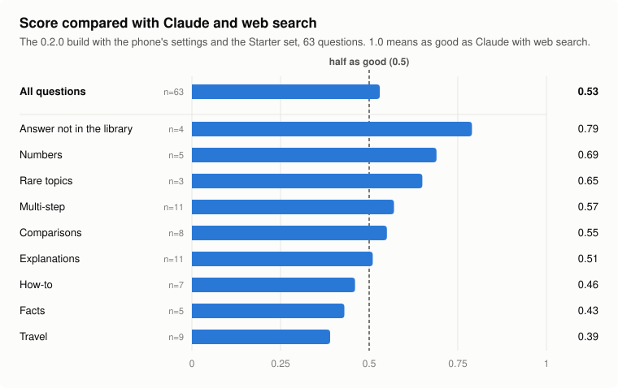
</picture>

### What fits on the phone

The starter set for 12 GB phones needs 11.3 GB, and the set for 8 GB phones needs 8.1 GB. Every pack together needs 36.5 GB, which leaves room under the 50 GB limit. The Gemma pack for Pixel 10 phones adds 3.1 GB.

<picture>
  <source media="(prefers-color-scheme: dark)" srcset="docs/images/chart-storage-dark.svg">
  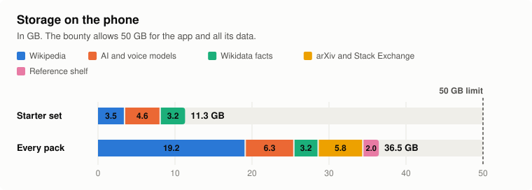
</picture>

## Under the hood

These two diagrams show the parts of the system and each step from a question to an answer.

<details>
<summary>Show the technical diagrams</summary>

### System overview

The desktop builds the packs. The phone imports them from files and never uses the network. In the Library, each knowledge pack and the Wikidata pack has an on/off switch. "My documents" indexes your own PDF, text or Markdown files on the phone.

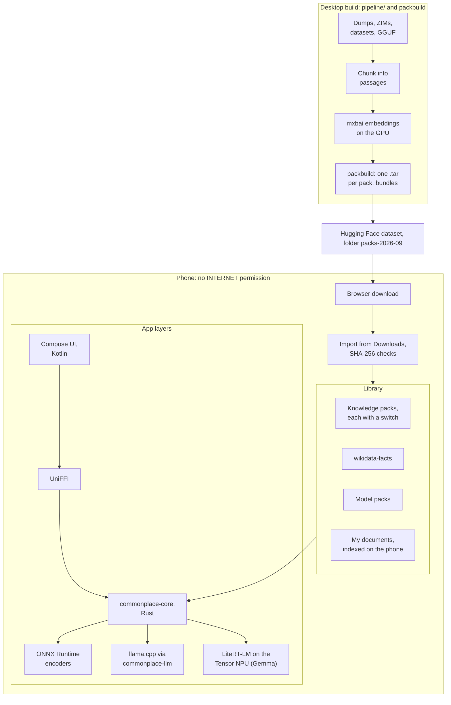

### From a question to a cited answer

The answer card appears after the rerank, before the model writes a word. The turn-kind head, the follow-up head and the intent head are small classifiers on the embedding of the question. A reformat or small-talk reply needs the language model. Without the model, such a message goes through search like a question.

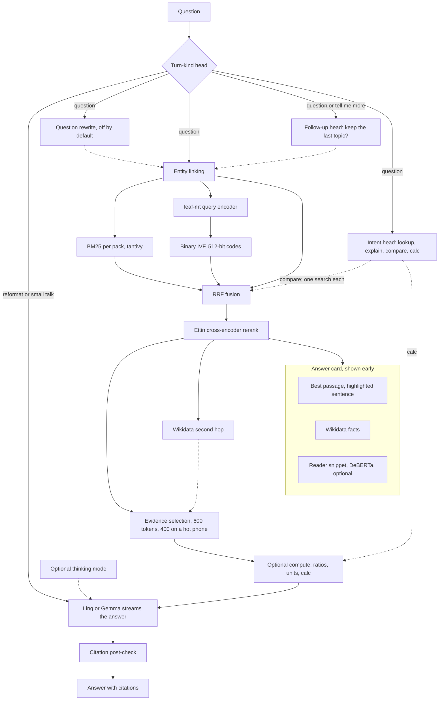

</details>

### Design choices

1. **Search in about one second.** Keyword search (tantivy BM25) and semantic search run in parallel. The semantic index holds 512-bit binary codes in an IVF index. The 23M-parameter leaf-mt encoder embeds the question. Reciprocal-rank fusion merges the two lists. An Ettin-17m cross-encoder then reranks the top 24 passages on the phone and the top 40 on the desktop. I distilled it from Ettin-400m on 23,012 of the app's own search pools ([0xPD33/ettin-reranker-17m-commonplace](https://huggingface.co/0xPD33/ettin-reranker-17m-commonplace)).
2. **An answer card before the answer.** The best passage, Wikidata facts and the source list appear before the model writes a word. The app highlights the sentence that matches. For a simple lookup, an extractive reader adds a short snippet.
3. **A small model writes the answer.** Ling-3.0-tiny (7.9B parameters in total, 1.3B active for each token, MIT license) runs fully in RAM through llama.cpp. Phones with 8 GB of RAM use MiniCPM5-2B (2.5B parameters, Apache-2.0). On a phone with a Tensor G5, Gemma 4 E2B (Apache-2.0) runs on the NPU through LiteRT-LM with speculative decoding: it reads the prompt at 800 to 2,000 tokens per second and writes 27 to 31. For the NPU, the app ships its own build of Google's Tensor dispatch library, because the prebuilt one crashes with LiteRT-LM 0.18.1 ([MODELS](docs/MODELS.md#runtimes)). Each model reads short evidence, not whole articles. The system prompt holds the rules and three worked answers. With llama.cpp, the app keeps the state of the system prompt in memory, so each question pays only for its own evidence. It also saves that state to a file, so after a restart the app loads the file and does not read the prompt again.
4. **Checks in code, not in a second model.** The app removes citations to sources that do not exist, and a list of sources that the model writes at the end of an answer. It underlines a sentence when the evidence does not have one of its numbers. It also underlines a sentence without a citation when the evidence does not have most of its rare words. When the sources do not answer a question, the model says so first and can then answer from general knowledge, and those sentences get the underline. Code does unit conversions, percentages and Wikidata ratios. A question that asks only for a conversion or a percentage gets the result from code, with no model call. For another calculation, the model writes an expression and code calculates the result.
5. **Comparisons and follow-ups.** A comparison runs one search for each item. When a name has several articles ("Mars"), the other names in the question and their Wikidata classes decide which one it means. Each Wikidata entity is a numbered source, so the answer cites its numbers. When a question asks about a related thing ("the highest point of the country that hosted the 1964 Olympics"), Wikidata follows one link to it. A trained head decides if a message continues an earlier turn. Such a message searches with the first sentence of the answer it refers to, which usually names the subject; the reranker picks that answer from the last two turns. A new topic does not take the old one. "Tell me more" searches the last question again and prefers passages that the last answer did not show. A request such as "make it shorter" rewrites the last answer and does not search again. "Are you sure?" searches the last question again, and the model checks its answer against the sources.
6. **Thinking mode.** The brain button next to the question box lets Ling reason before it answers. The default budget is 256 tokens. Settings has a slider for the budget.
7. **Your own documents.** "My documents" turns a PDF, text or Markdown file into a small pack on the phone. Citations show the page. "Ask this document" limits a conversation to one document. PDF import needs Android 15, or Android 12 to 14 with the newest system updates.

The app also has a History screen and a reader for passages and articles. Each source shows its credit, license and URL. A question rewrite step ("Understand the question first" in Settings) is off by default: it fixes typos and follow-ups, but it adds a few seconds.

## Results on the Pixel 10

| Measure | Gemma 4 E2B on the NPU | Ling-3.0-tiny on the CPU |
|---|---|---|
| Answer card (search, rerank, best passage) | 0.61 s median | 0.50 s median |
| First word of the written answer | 1.9 s median | 7.2 s median |
| Full answer | 7.5 s median | 40 s median in a session of 25 questions |
| Writing speed | 25 to 31 tokens/s | 16 to 17 tokens/s on a cool phone, about 8 tokens/s after the phone passes about 37 °C |
| Long session | 126 questions in 76 minutes, first word 2.8 s at most | The median first word rose from 13 s to 28–30 s over 75 questions |
| Model start after the app was closed | 6 to 9 s | About 16.5 s (about 25 s without the saved warm-up state) |
| Peak memory | 2.3 GB | 5.3 GB |

The Gemma column comes from the 63 seed questions on the 0.3.0 build (2026-10-23) and the model start on 0.3.2 (2026-10-24). The Ling column comes from the builds of 2026-10-13 to 2026-10-19. [docs/BENCHMARKS.md](docs/BENCHMARKS.md) has all measurements with their dates and builds.

Known limits:

- Ling and MiniCPM on the CPU get slower when the phone gets hot. Gemma on the NPU kept its speed over 126 questions in 76 minutes (first word 2.8 s at most), but those runs did not make the phone hot ([BENCHMARKS](docs/BENCHMARKS.md#long-sessions-and-heat)).
- Without the Reference shelf, long-tail (0.40), travel (0.41) and fact questions (0.42) are the weakest categories ([EVAL](docs/EVAL.md)).
- Voice input (Moonshine, on the phone) is English only and needs the optional `voice-en` pack. Real speech recognition is tested on the desktop, not yet on a phone's microphone.
- Only a Pixel 10 (Tensor G5) runs Gemma 4 E2B on its NPU, with the Gemma pack. Other phones answer on the CPU. On 63 seeds asked on the phone, Ling's answers win more often head to head (33 / 7 / 21, not significant), and the score ratios are close (0.499 against 0.533). The judge rates Gemma's answers as correct as Ling's, but less complete ([BENCHMARKS](docs/BENCHMARKS.md#litert-lm-gemma-4-on-the-gpu-and-the-tensor-npu-2026-10-22-to-2026-10-23)).

## Desktop command line

The same Rust core runs on a desktop computer. The desktop build is the one that the evaluation uses.

```sh
nix develop            # or install the tools listed in docs/INSTALL.md
scripts/fetch-models.sh encoders llm-fast
cd core && cargo build --release -p commonplace-cli -p packbuild && cd ..
core/target/release/commonplace --model data/models/llm/Ling-3.0-tiny-Q4_0.gguf ask "Why is the sky blue?"
```

The command line reads packs from `data/library/packs/`. To install a pack or a bundle there, run `tar -xf <file>.tar -C data/library/packs`. To keep the warm-up state between runs, as the app does, add `--llm-state data/llm-state`. [docs/PACKS.md](docs/PACKS.md) shows how to build packs.

## Repository

| Path | Contents |
|---|---|
| `core/` | Rust workspace: `commonplace-core`, `commonplace-llm` (llama.cpp bindings), `commonplace-ffi` (UniFFI), `commonplace-cli`, `packbuild` |
| `android/` | Kotlin and Jetpack Compose app |
| `pipeline/` | Python build steps: Wikipedia dump conversion, converters for the other packs, Wikidata, dense codes, license notices |
| `eval/` | Evaluation harness (Claude with web search as the baseline and the judge) and the runs that the docs cite |
| `scripts/` | Model and data downloads, Android build, emulator, end-to-end test driver, release |
| `docs/` | [INSTALL](docs/INSTALL.md), [MODELS](docs/MODELS.md), [DATASETS](docs/DATASETS.md), [PACKS](docs/PACKS.md), [BENCHMARKS](docs/BENCHMARKS.md), [EVAL](docs/EVAL.md) |
| `third_party/llama.cpp` | llama.cpp at tag `b11240` (git submodule) |

## License

The code is under Apache-2.0 ([LICENSE](LICENSE)).

The packs and models keep the licenses of their sources. For example, Wikipedia is CC BY-SA 4.0 and GFDL, Wikidata is CC0, Ling-3.0-tiny is MIT, and MiniCPM5-2B and Gemma 4 E2B are Apache-2.0.

- Each pack contains a `NOTICE.txt` with its credit, license and full license texts. The sources of these files are in [pipeline/notices](pipeline/notices).
- [docs/DATASETS.md](docs/DATASETS.md) lists the license of each pack. [docs/MODELS.md](docs/MODELS.md) lists the license of each model.
- The app shows the licenses of its own dependencies in **Settings > Open-source licenses**. `scripts/licenses.py` makes that list.
